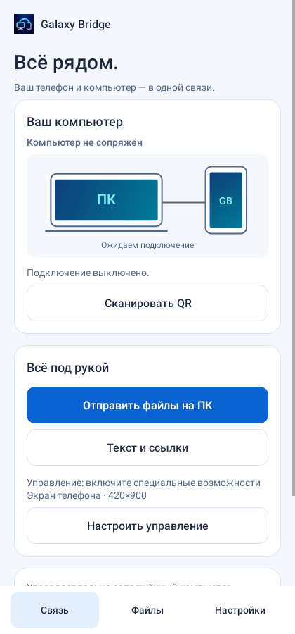
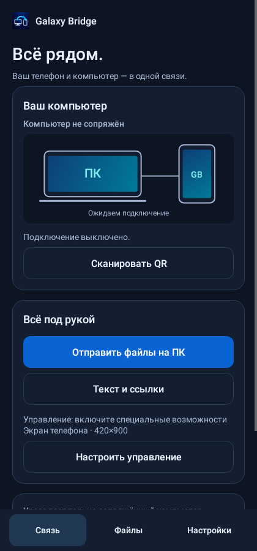
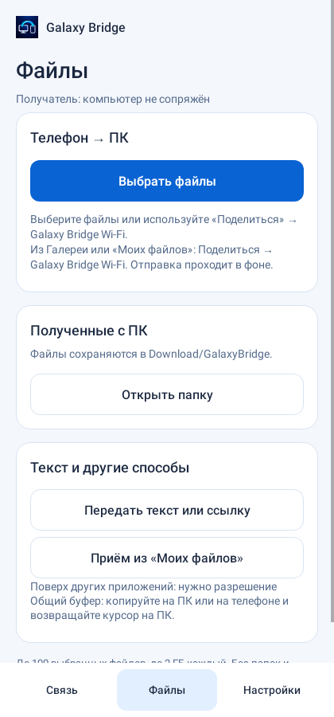
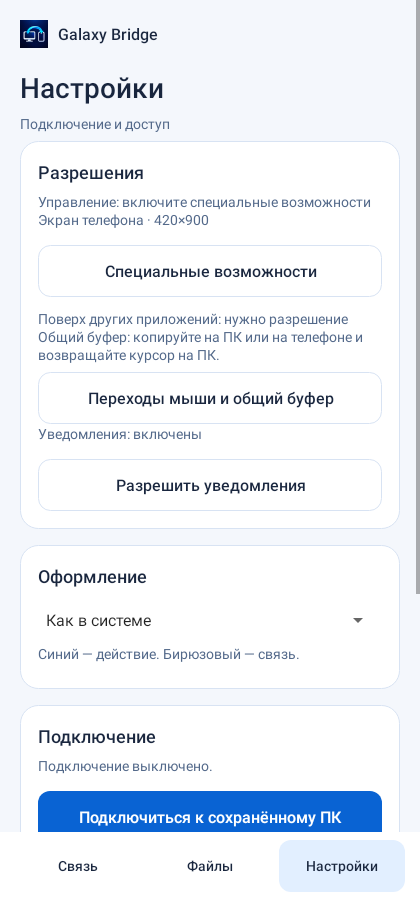

# Дизайн Galaxy Bridge · 0.7.31

Реализация общего концепта от 10 октября 2026 года в существующих Windows и
Android приложениях. Иконка проекта сохранена. Карточки, типографика, темы,
состояния связи и основные действия используют один визуальный язык.

| Назначение | Цвет |
| --- | --- |
| Тёмный фон | `#0D1422` |
| Тёмная поверхность | `#131E30` |
| Светлый фон | `#F4F7FC` |
| Основное действие | `#0963D3` |
| Связь в тёмной теме | `#49DBDF` |
| Успех в тёмной теме | `#75D5AD` |

В Windows используются Segoe UI, боковая навигация, карточка устройства и схема
расположения телефона. Разделы: Устройства, Управление, Файлы, Настройки. QR
открывается отдельно, а файловое окно и независимый виджет оформлены одинаково.
Светлая/тёмная тема задаётся вручную или следует системной настройке приложений.
Настройка сохраняется. Список последних передач содержит только успешно
завершённые файлы текущего сеанса, до десяти записей.

На Android используются системный шрифт и нижняя навигация: Связь, Файлы,
Настройки. Все основные действия подписаны. Карточки и кнопки подстраиваются
под текст; содержимое прокручивается выше нижней навигации. Системные панели
и клавиатура учитываются через WindowInsets. Выбор оформления хранится отдельно
от данных сопряжения. Отправка через системное «Поделиться» остаётся фоновой.

Изображения ниже отрисованы из настоящих Android views через Robolectric native
graphics, при ширине 420 dp. Это проверочные экраны без реального соединения,
не снимки S25. Внешний вид WinForms проверен компилятором; его отрисовка на Windows
и работа при разных DPI требуют проверки на ноутбуке.

| Связь · светлая | Связь · тёмная |
| --- | --- |
|  |  |

| Файлы | Настройки |
| --- | --- |
|  |  |
