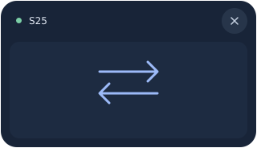

# Дизайн Galaxy Bridge · 0.8.2

Минималистичный интерфейс Windows и Android: спокойные поверхности, один синий
акцент, короткие заголовки и меньше повторяющихся пояснений. Иконка сохранена.

[Общий предпросмотр](ui/minimal-preview.png).

| Назначение | Светлая тема | Тёмная тема |
| --- | --- | --- |
| Фон | `#F5F6F8` | `#15181E` |
| Поверхность | `#FFFFFF` | `#1D2129` |
| Основной текст | `#202630` | `#EEF0F4` |
| Вторичный текст | `#636D7D` | `#A2AAB8` |
| Действие | `#356BD9` | `#356BD9` |
| Выбранный раздел | `#EBF1FD` | `#28344B` |
| Связь установлена | `#247B52` | `#7BCEA6` |

Windows: Устройства / Управление / Файлы / Настройки. Главный экран содержит
устройство, короткий статус связи и быстрые действия. Схема расположения
телефона находится в «Управлении». Диагностика, новый QR и помощь доступны
в «Настройках». На первом запуске QR и инструкция видны на главном экране.
Кнопки отмены появляются при передаче. Важные ошибки остаются видимыми.

Android: Связь / Файлы / Настройки. Убраны декоративная схема, слоганы,
повторная строка бренда и дублирующие пояснения на главном экране. При
сохранённом сопряжении QR доступен в настройках; восстановление связи не
требует повторного сканирования. Разрешения управления доступны там же.

Системная, светлая и тёмная темы сохраняются отдельно от сопряжения. Крупный
шрифт, перенос длинных надписей, прокрутка, системные панели и клавиатура
учитываются. Фоновая отправка и остальные функции сохранены.

## Виджет

Логический размер 320×184; при другом DPI он масштабируется. Плоский корпус
`#182438`, внутренняя область `#1D2B41`, стрелки `#9CBAF8`. Рисуется кодом,
без растрового макета, градиентов и свечения. Системной рамки нет.

В заголовке — индикатор связи, имя телефона и круглая кнопка закрытия 32×32.
Нет связи: короткая надпись, подробности в подсказке. При передаче видны
результат/имя файла, прогресс и «Отмена»; неизвестный размер не показывает
выдуманных процентов. Нажатие на стрелки выбирает файлы, перетаскивание
работает во внутренней области, заголовок и края перемещают виджет.
Прозрачность 0–80%, положение, клавиатура и доступность сохранены.

Схема по размерам реализации (не снимок работающего Windows-окна):

## Проверочные экраны

Снимки ниже получены из настоящих Android views через Robolectric native
graphics при ширине 420 dp, без реального соединения. Это не снимки S25.
WinForms проверяется компиляцией; визуальная проверка Windows и реального
масштабирования/DPI остаётся проверкой на ноутбуке.

| Связь · светлая | Связь · тёмная |
| --- | --- |
|  |  |

| Файлы | Настройки |
| --- | --- |
|  |  |
